# Dry Town

An open-ended Prohibition-era crime strategy game, inspired by how *Gangsters: Organized Crime* (1998) plays. It is a new game. It uses none of the original's art, audio, text, code, data or name.

There is no win screen; the city keeps running. Phase 1 built the rules. Phase 2 made a week playable: you plan it on a district map, then watch it happen on the streets. Phase 3 made it a game you can keep coming back to. It saves itself every Sunday, you can run crews under lieutenants, you can step in during the week, and it has sound. Phase 4 let the game outlive your boss: men grow old and die, and the outfit passes to an heir. Phase 5 added politics and bigger cities, and Phase 6 added a huge one. Phase 7, the current state, draws the city at an angle the way Gangsters: Organized Crime did, with buildings standing up off the map, and adds a metropolis split by a river. It also puts people on the street you can deal with (drifters to hire, beat cops to pay off, reporters to buy and witnesses to lean on) and harder crimes: arson, hits, bank jobs and hijacked beer trucks, plus bookies, gambling dens and counterfeiting presses. The city now comes in five sizes, the largest with twenty wards and nine outfits, and every ward has an alderman who can be bought, a mayor who can be backed, and elections that can turn them all out. Since then the crew has a rolodex of mugshots down the side of the screen, your men can carry guns and drive cars bought from the city's gun shops and motor dealers, you can buy businesses outright as fronts to wash your money before the tax men come for it, and a man charged with anything serious goes before a jury, where a lawyer, a paid judge or a visit to the jurors can still get him off. The outfits also talk to each other now: they hold grudges, agree truces, pay or demand tribute, and band together against whoever runs too much of the city. Every man has a rap sheet, and a man with three convictions behind him who is convicted again goes away for life. Elections are bigger too: you can run one of your own men for alderman, send men to lean on voters, and back a district attorney on the mayor's ballot, and every vote is counted ward by ward. The city has its own news, too: the Crash and the Depression come on the calendar, and heat waves, conventions, title fights, newspaper crusades, police shake-ups, strikes and fires come when they please.


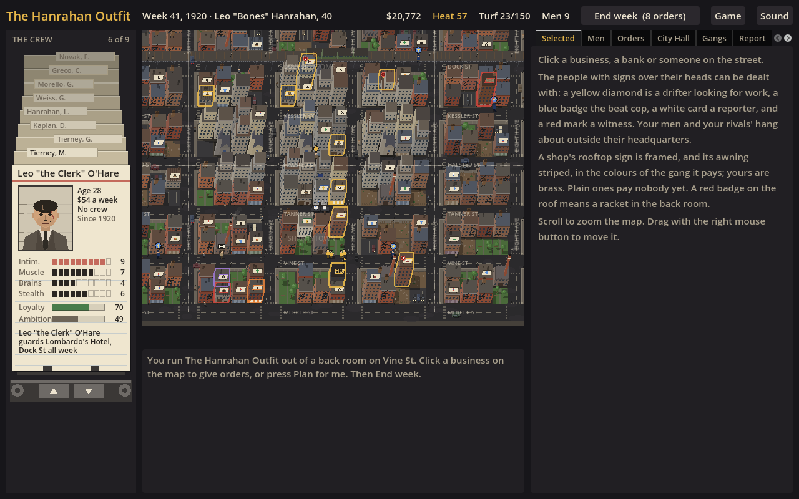

## Layout

| Folder | What it is |
| --- | --- |
| `core/` | The simulation, in plain C# with no Godot dependency. All game rules live here. |
| `sim/` | Console runner: play in the terminal, or soak-test long games. |
| `tests/` | xUnit tests, including the Phase 1 gate (ten-year cities stay contested) and player survival. |
| `godot/` | Godot 4 (.NET) game: district map, planning panels, live week and Sunday report. |

## Run it

You need the [.NET 8 SDK](https://dotnet.microsoft.com/download/dotnet/8.0). To play the game, install the **.NET edition** of Godot 4.7, open `godot/project.godot` and press Play. If your editor is a different 4.x version, it updates the version in `DryTown.csproj` when it opens the project.

```sh
dotnet test tests                                                    # 141 tests
dotnet run --project sim -- play --seed 42                           # play in the terminal
dotnet run --project sim -- soak --seeds 40 --years 10               # balance check across many cities
dotnet run --project sim -- soak --seeds 40 --years 10 --difficulty Hard
dotnet run --project sim -- soak --seeds 40 --years 10 --size Large   # Small, Medium, Large, Huge or Metropolis
```

## How a week works

1. **Plan (Monday morning).** Click a business on the map, and the **Selected** tab shows what you can do there. If it pays nobody, send a man to lean on the owner; the panel shows his chance. If it pays a rival, send a man to take it, and the panel shows his odds if it is unguarded; you can also burn it down, or hijack its beer truck if it runs a speakeasy or a still. On your own turf you can set the protection rate, open a racket in the back room, or post a guard for the week. Banks and people on the street can be clicked too (see **The street** below). The **rolodex** down the left side has a card for every man: his mugshot, his four skills, his loyalty and ambition, and what he's doing this week. Roll the mouse wheel or press the arrows on its base to flip through it, click a card's tab to jump to that man, and click the front card to find him on the map. The **Men** tab shows the same men as a table. On the **Orders** tab you can cancel orders, or press **Plan for me** to have the AI fill your week.
2. **Watch (Monday to Saturday).** Press **End week**. Each order happens at its own hour. Your men walk the streets from your headquarters to the job, or drive if one of them has a car, and rival gangs and the police do the same. Rings show the outcome: green for success, red for a lost fight, blue for an arrest. A cross marks where someone died. Shops change colour as they change hands. The ticker logs each event as it happens. You can pause, play at 1×, 2×, 4× or 8×, or skip.
   **Stepping in.** Click a business, a bank or someone on the street at any time during the week and the clock pauses. You can send a free man or crew to lean on it, take it, or guard it for the rest of the week. They set out from headquarters straight away and the job happens when they arrive. You can also see rival men walking to their jobs, so you can try to get a guard to a shop before they reach it. New orders stop early on Sunday morning.
3. **Report (Sunday).** Collectors make their rounds, then the police, the Treasury and the gangs settle up. The **Report** tab shows the books and the week's headlines, with your own in bold.


## The street

People who aren't in any gang stand about on the pavements, each with a sign over his head so you can find him from across the city. Click one and the **Selected** tab says who he is and what you can do with him.

- **Drifters** (a yellow diamond) are looking for work. Unlike a stranger off the boat, you can see a drifter's skills before you hire him, and a good one asks more. He moves on after a few weeks.
- **Beat cops** (a blue badge) walk one ward each. Slip one $150 and he looks the other way for the week: your heat drops, and if the police raid you that week they leave your rackets in his ward alone. An honest one won't take it and writes you up instead. The panel tells you which ones look honest.
- **Reporters** (a white card) turn up when a gang runs hot. In a few weeks the story runs: the gang's heat jumps, and so does the city's outrage, which helps the reformers at the polls. You can buy a story about you before it runs; the price goes up with your heat.
- **Witnesses** (a red mark) saw one of your men do something. Unless someone has a word with him first, he testifies and your man goes away for months. A witness with nerve won't scare, and then he goes to the police at once.
- **Rival men** hang about outside their headquarters, and so do yours. Click a rival to put out a hit on him. A boss with soldiers round him is much harder to reach. Someone may see it, and if it goes wrong your man may not come back.

The heavier crimes:

- **Arson.** Burn out a business a rival protects. It stays shut for two months, its racket is gone, and the map shows a blackened shell. A guard on the door makes it much harder.
- **Bank jobs.** Every other ward has a bank. The man in front plans the job, so brains count, and the backup holds the room. Guards, a precinct round the corner and a recent hold-up all count against you. A good take is thousands of dollars, but it brings a lot of heat, and if it goes wrong men are shot or go away for a year or more. The vault fills up again over a couple of months.
- **Hijacking.** While Prohibition lasts, stop a rival's beer truck on its way to his speakeasy or still. You sell the load and he's out of pocket. The drivers ride armed.

Three new rackets go behind your businesses: a **bookie's counter** (pool halls, diners, barbers and tailors), a **gambling den** (hotels, pool halls and warehouses) that pays well but draws heat, and a **counterfeiting press** (warehouses, laundries and garages) that pays best and draws little heat from the precinct, but the Treasury finds a press now and then. When it does, it fines the gang, shuts the business and sends the man who runs it away.

Rival outfits do all of this too. They hire good drifters, buy their own stories, silence witnesses, pay cops when they run hot, rob a bank when money is short, hijack and burn out their neighbours, and now and then put out a hit on a rival's best man.


## Guns and cars

Every other ward has a sporting-goods store with rifles on its sign, and every fourth a motor dealer with cars on the forecourt and pennants strung over them. Click one and the **Selected** tab sells to whichever of your men you pick. You can also click a man's card on the rolodex and press **Find a gun shop** or **Find a car dealer**. Whatever he has already is traded in for half what it cost.

| Gun | Price | What it does |
| --- | --- | --- |
| .38 revolver | $90 | +1 strength, 2% likelier to scare an owner into paying |
| Sawed-off shotgun | $220 | +2 strength, 3% likelier |
| Thompson gun | $700 | +3 strength, 4% likelier, +2 heat whenever it's used in a fight, and more men die when it's used to take a business |

A gun counts in every fight: taking a business, guarding one, hits and hijacks. Going in through someone else's door it counts for half, because the men inside have cover. A man keeps his gun if he's arrested (it waits for him at headquarters, and you can hand it to someone else) but loses it if he's killed.

| Car | Price | Speed | Getaway |
| --- | --- | --- | --- |
| Ford Model T | $450 | 1.6× walking | 25% |
| Packard sedan | $1,500 | 2.2× walking | 40% |
| Armoured Cadillac | $4,000 | 1.8× walking | 55%, and a man who rides in one is much harder to hit |

The best car on a job carries everyone on it. It gets them there sooner, which matters when you send men mid-week, and when a job goes wrong the getaway share is how much less likely each man is to be shot or picked up. A getaway car also helps a bank job. During the live week you see the gang's car drive to the job, the men get out at the door, and drive home again. The rolodex shows what each man carries and drives, and you can hand a gun or a car from one man to another.

Rival outfits arm themselves too, once they have money to spare: revolvers for about half their men, a car or two, a shotgun or a Thompson for their hardest man, and an armoured Cadillac for a rich boss.

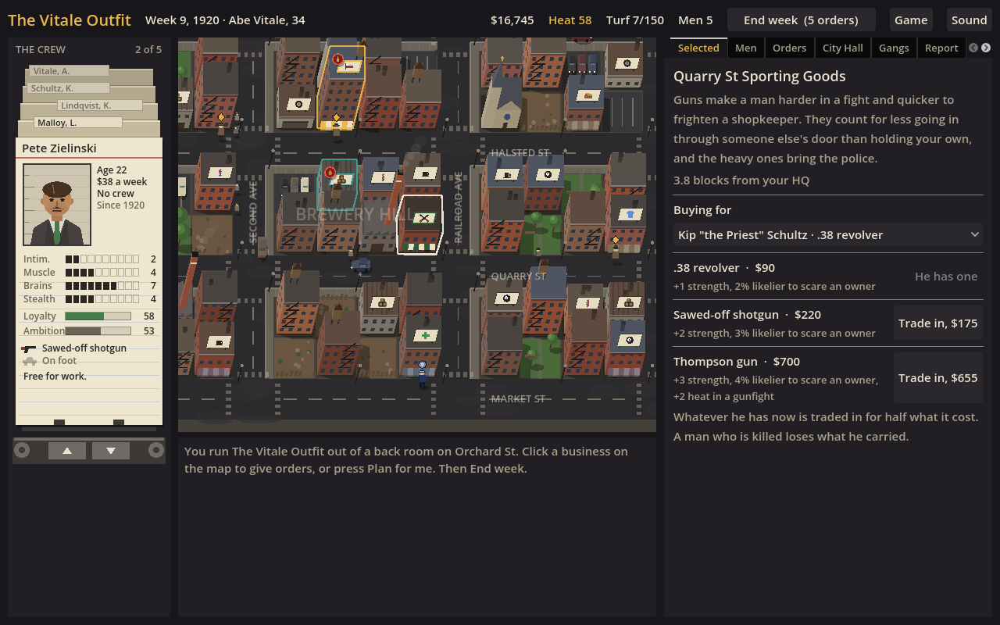
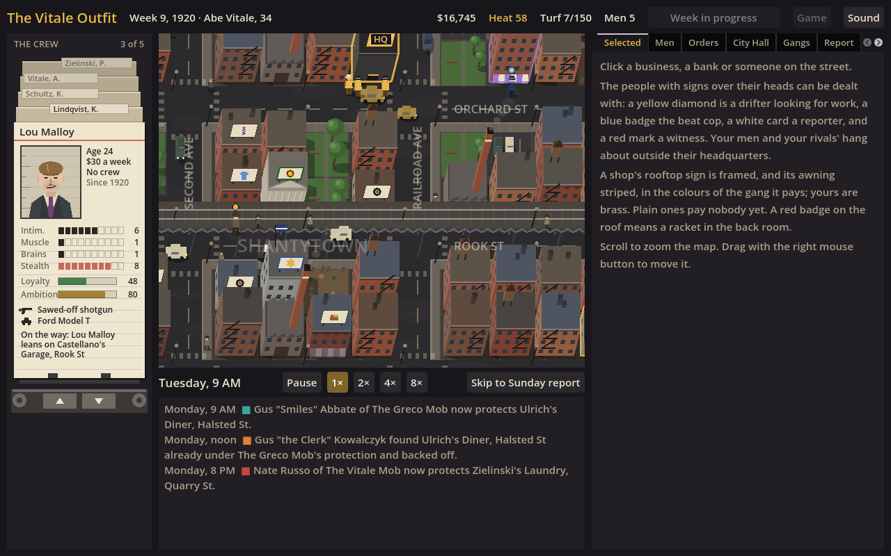

## Fronts and laundering

The money a gang takes is dirty. Hold more than $25,000 of it and the Treasury may bring a tax case: it can't be bribed, it seizes 40% of the dirty money, and it can send the boss away for years. Money that has been through a legitimate business's books is clean, and the tax men can't touch it.

Any business you protect can be bought outright for 25 weeks of its takings. Click it and press **Buy it** on the **Selected** tab, or type `buy <business>`. Once it's yours:

- It stops paying you protection, and its owner stops resenting you.
- It makes 15% of its takings a week in honest profit, which comes in clean. That is more than the usual 12% protection would have paid.
- Every Sunday it washes up to half a week's takings of dirty money. The bookkeeper keeps 15% of what he washes.
- It only works while your men still watch it and it's open. If a rival takes it, or it's burned or raided shut, it washes nothing until you have it back.

Clean money is spent last, so the bills come out of the dirty money first. The top bar's cash turns red once the dirty money is enough for a tax case, and its tooltip shows the split. The **Report** tab shows the fronts' profit, the bookkeeper's cut and how much was washed, and `fronts` in the console lists them all. A front wears a banknote on its roof, edged in its owner's colours.

Rival outfits buy fronts too, once they hold enough dirty money for a tax case: the best business on their turf first, and one more for every eight they protect. The biggest outfit in town doesn't bother. Nothing that size can be hidden from the Treasury, and the tax men are part of what keeps it from running the whole city.

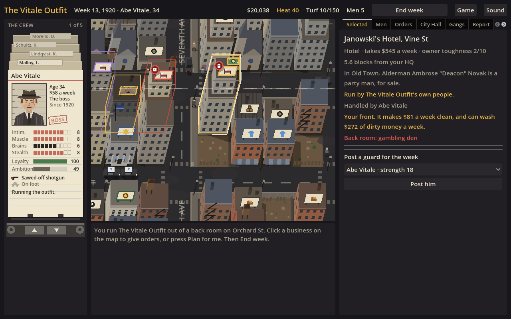
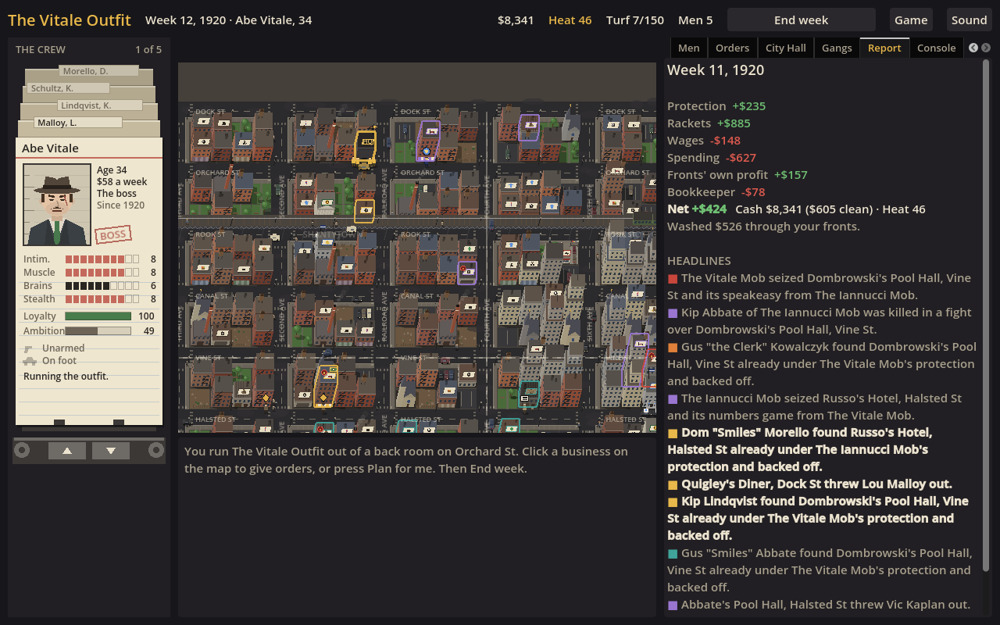

## Lawyers and trials

A man picked up on a petty charge, eight weeks or less, is dealt with by a magistrate the same day and goes straight to his cell. Anything longer goes to a jury. He is held for three weeks, and then the jury decides. Without help, a city jury convicts 85% of the time and a federal one 90%. A conviction sends him away for the rest of his sentence, and the weeks he waited count against it. An acquittal sends him home a little more loyal than before. A man with no love for the outfit who is facing six months or more may turn state's evidence instead, and that brings a lot of heat.

The **City Hall** tab has a **Courts** section listing every man of yours waiting on a trial and the odds against him. There are three ways to help him:

| Help | Cost | Odds of a conviction |
| --- | --- | --- |
| A storefront lawyer on retainer | $60 a week | 15 points lower |
| A downtown mouthpiece on retainer | $220 a week | 30 points lower |
| Pay off the judge | $400 plus $20 a week of the sentence, twice that under a reform mayor; a little heat | 35 points lower. A federal judge can't be bought. |
| Send a man to lean on the jury | His week, and the risk: a man caught at it faces his own charge | 25 points lower |

A lawyer hired after the arrest has only weeks to prepare and does half as much, so a retainer is worth keeping before you need it. A lawyer who isn't paid on Sunday drops you. The odds never fall below 5%.

Rival outfits only go to court seriously for the boss and his heir. While one of them is waiting on a trial they hire a lawyer, and a rich outfit pays the judge in its boss's case. They don't tamper with juries. In testing, rivals who hired lawyers for every man kept so many of their men out of prison that your gang lasted far less often, so the courts mostly help you.

The console has `cases`, `lawyer <none|storefront|mouthpiece>`, `judge <hood>` (paid on the spot) and `jury <hood> <defendant>` (queued for the week).

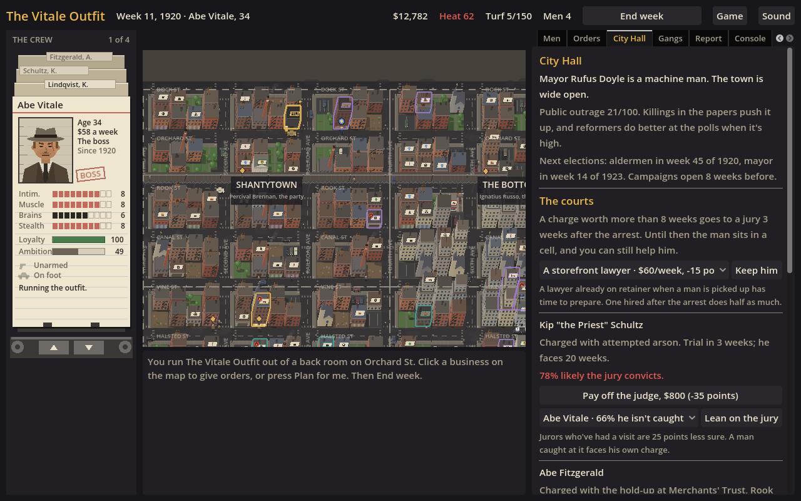

### Rap sheets

Every man keeps a record. The police side lists each arrest, the charge, what he faced and how it came out: a magistrate's few weeks, a jury's verdict, or the day he turned state's evidence. The other side is his work for the outfit: shops he shook down, businesses he took from rivals, men he killed, fires he set and banks and trucks he hit.

The record counts in court. Each conviction already on it makes the next sentence half as long again, so a man with two behind him faces twice the stretch. Under the habitual offender law, a man with three convictions who is convicted a fourth time goes away for life, and the outfit loses him for good. Petty charges settled by a magistrate don't count. The courts panel says when a man is facing life, and that is when a lawyer, the judge or a word with the jury matters most.

Click **rap sheet ›** in the corner of a rolodex card, or right-click the card, to turn the cards over and read the sheets. Clicking any man on the map, yours or a rival's, shows his work and the last few lines of his record. The console has `sheet <hood>`.

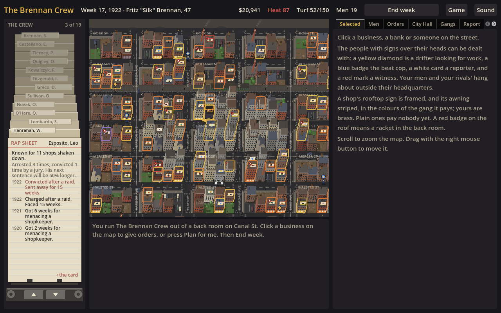

## Rats

Loyalty matters most when a man is in trouble.

- **The DA's deal.** A man held for trial, or serving a long stretch, has visits from the district attorney's office. If his loyalty is under the line, he may start talking, and the Men tab and the courts panel warn you. Two weeks later, or at his trial if that comes first, he signs. His own charge goes away and so does he. He names two of his friends, his own crew first and then whoever has done the most (three if he ran the crew), and each is charged on his word with a jury four times in five sure to convict before anyone helps. A lieutenant, the heir or a man two years in the outfit may name the boss as well. Any racket he looked after is closed. The line is 35 loyalty for a short stretch and climbs with the sentence, to 60 for a man facing life.
- **Keeping him quiet.** Look after his family (from $150, more for a long stretch, $1,500 for life) and his loyalty goes up 30, which is enough if it puts him over the line. Otherwise have him seen to: a man goes to the jail, and if he gets to him the rat is found hanged in his cell. If the guards catch your man, he's charged with conspiring to murder a witness, and the rat signs at once.
- **Informers.** A man on the street with loyalty under 30 may quietly start telling the police what the outfit is up to, and nobody knows. The precinct raids sooner, an alderman's or a beat cop's tip-off no longer saves the rackets, heat creeps up, and now and then the DA brings a case against one of your busiest men. When a raid or a case gives it away, the Men tab says somebody may be talking. Send a man to ask around: the more brains he has, the likelier he finds each rat. A rat who is found out runs within two weeks, straight to the DA, unless you have him seen to first. An informer whose loyalty climbs back over 50 stops.
- **Men inside.** Send a man to sign on with a rival outfit. A quiet man nobody has seen at work gets in more easily than a known killer. While he's there he's off your books, and every Monday he tells you what that outfit means to do to you that week: which of your businesses it will move on, what it will burn and whom it will go after. Your jobs against it go better (+2 strength taking one of its businesses; 15 points likelier on hits, fires and hijacks, 30 on a hit on its boss), and its jobs against you go worse. Each week there's a 2 to 5% chance he gives himself away, and they kill him. Bring him home whenever you like.

Rival outfits do all of this too. They pay a talker's family or have him seen to, ask around when the police seem too well informed, and the aggressive ones plant a man on the outfit they hate most, which may be yours. The outfit that runs a third of the city draws twice the DA's visits and twice the informers. Plan my week does everything here for you except plant a man, which is left to you. When one of your men finds a rival's plant, you decide what's done with him. What your men inside hear, and what you pay to keep a man quiet, is yours alone: it shows in your report but never in the headlines. The console has `rats`, `care <hood>`, `seeto <hood> <rat>`, `hunt <hood>`, `plant <hood> <gang>` and `recall <hood>`.

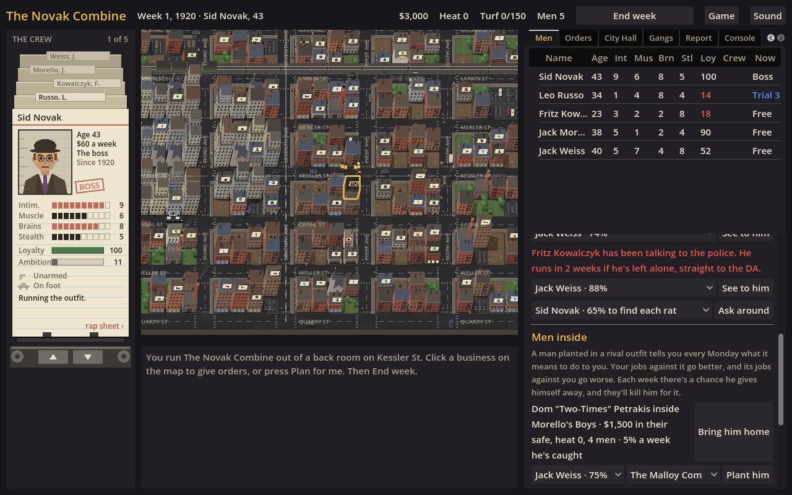

## Diplomacy

Every outfit remembers who hurt it. A takeover, a fire, a hijacked truck or a hit leaves the victim with a grudge against the gang that did it, worth more for a dead boss than for a burned shop, and the victim's allies take half of it on too. Grudges fade a little every week.

The **Gangs** tab lists every outfit and where you stand with each. Pick one to talk terms:

| Deal | What it does | Who agrees |
| --- | --- | --- |
| Truce | Neither side moves on the other's turf or men for three months | Almost anyone. An outfit much stronger than you, or one that hates you, wants paying for it. |
| Truce with tribute | One side pays the other every Sunday for the truce. If the money isn't there, the truce is off. | The tribute asked is a fifth of what the payer's turf brings in. |
| Alliance | A truce for a year, and an attack on either partner makes the attacker an enemy of both | Only while some third outfit is bigger than both of you, and only if they trust you |
| Demand tribute | You leave a much weaker outfit alone for a weekly envelope | Outfits a little over half your strength or less. Refusing you is an insult. |

The rivals do the same among themselves once a month, and put proposals to you. These wait at the top of the Gangs tab for two weeks. A truce, an alliance or a payment offered to you costs nothing to take. A demand for tribute does, and turning it down, or not answering, makes an enemy.

Your word is worth something. Rivals keep their pacts. If you send men against an outfit you have a pact with, the pact is broken, they hate you for it, every other outfit thinks less of you, and nobody will sign anything with you for a year. The map's business panel warns you before you give that order. An aggressive rival that has grown to twice its partner's strength may tear up a pact too.

**Plan for me** answers proposals the way the rivals would: it takes any truce or alliance and pays tribute only to an outfit much stronger than you. Once a month it also looks for terms of its own, a truce when an outfit your size or bigger is giving you a beating, or an alliance when one outfit holds a third of the city. It never breaks your word and never demands tribute; that's left to you.

The console has `relations`, `truce <gang> [tribute]`, `ally <gang>`, `demand <gang> <dollars>`, `break <gang>`, `accept <offer>` and `decline <offer>`, all answered on the spot.

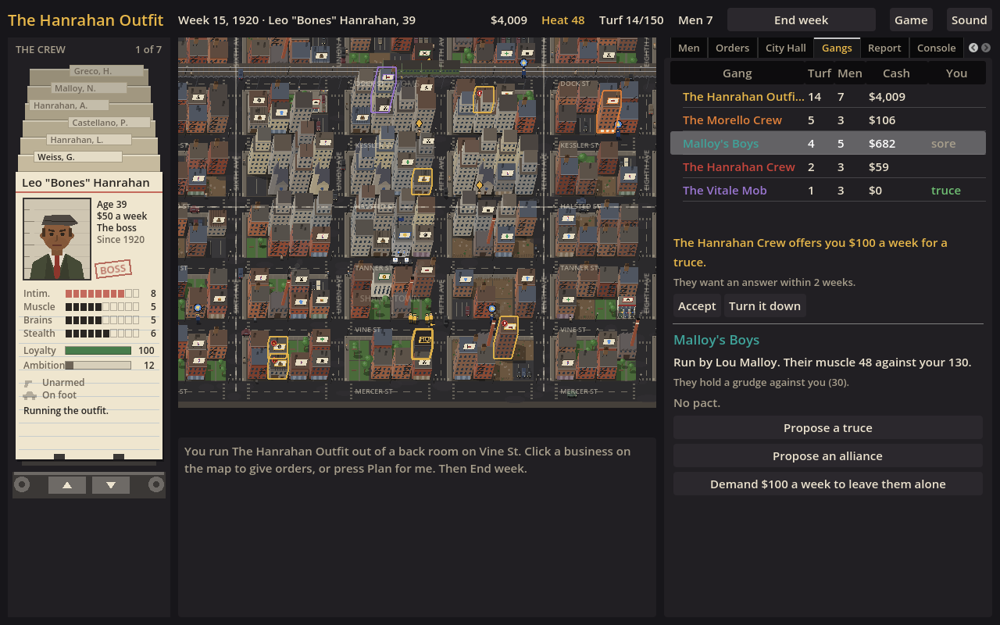

## City Hall

The city is split into wards, and each ward has an alderman. Open the **City Hall** tab and the map shows the wards, each washed in the colour of the outfit that owns its alderman. Click a ward on the map or in the list to see who runs it.

- **Aldermen.** A party man can be put on your payroll for a one-off envelope, then a weekly one that grows with the number of shops in his ward. While he's yours, he tips off your rackets in his ward before the police arrive, makes shopkeepers' complaints go away, and cools your heat a little every week. A man who just took one outfit's money won't hear another offer for half a year; after that a rival can turn him for double. Miss a Sunday envelope and he stops taking your calls.
- **Reformers.** A reformer won't take an envelope, and offering one gets you in the papers. The only way to be rid of him is to beat him at the polls.
- **Elections.** Aldermen are elected every second November and the mayor every fourth April. For eight weeks before each vote you can put money behind your man. Money counts, so do the shops you run in his ward, and so does a sitting alderman's machine. Every $400 you spend on the street draws a little heat.
- **Your own man on the ballot.** While the aldermen's campaign is on you can run one of your men in a ward. He needs brains of 5 or more and a clean record, and he can't be the boss or your heir. He counts for more than money alone, and the money you put into the ward backs him. If he wins he leaves the street for good, but the seat is yours: he takes no envelope, nobody can buy him, and his machine is stronger than a bought man's at the next vote. If he's jailed before the vote, he's off the ballot.
- **Working the polls.** In the last two weeks of a campaign you can send a man to lean on voters in a ward. Each week he's there turns out votes for your man, or for the machine's ticket in a mayor's year, worth about what a few hundred dollars would buy. It draws heat and outrage, and a man who's picked up is charged with intimidating voters. Reformers watch their own polls, and a reform mayor's police watch everyone's.
- **The mayor.** A machine mayor leaves the town wide open, and the outfit that paid most for his win has the police go easy on it. A reform mayor's police raid sooner and his aldermen cost twice as much to buy. Killings in the papers drive up public outrage, and outrage wins elections for reformers.
- **The district attorney.** He runs on the mayor's ballot, and the winning mayor's coat-tails help his side's man. A reform DA pushes every case in the city courts 5 points harder. A machine DA owes the outfit that paid most for the ticket, and its men's cases go 10 points softer. Federal cases are out of his hands.
- **The count.** Every race is counted. The log gives each winner's share of the vote, and the City Hall tab shows the last count in the selected ward and for mayor and DA, candidate by candidate.

Rival outfits play too. They buy the alderman where they do most of their business, defend him at election time, and back the machine's man for mayor when they can afford to. A big outfit with men to spare runs one of its own where it runs the most shops, and sends its most frightening spare man to the polls in the last weeks.

The console has `wards`, `stand <hood> <ward>`, `polls <hood> <ward>` and `results`.


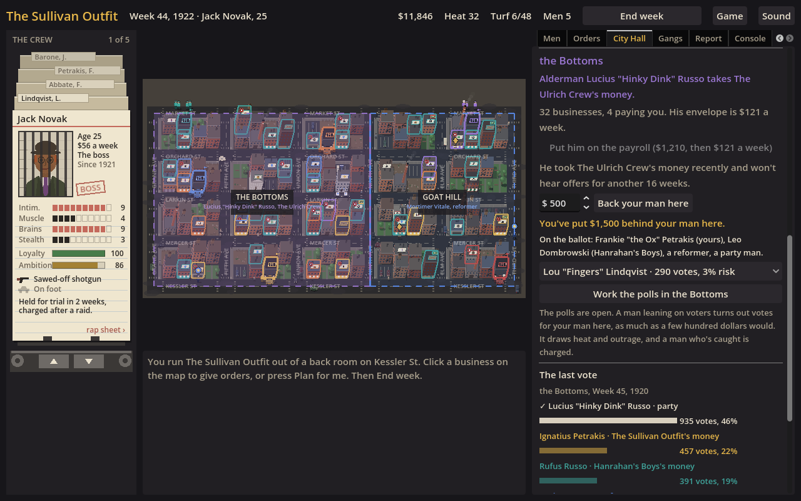

## The city in the news

Things happen to the city that no outfit controls. When one breaks, the Tribune puts out an extra, and for as long as it lasts it is listed under **In the papers** on the Sunday report and at the top of the City Hall tab. The console's `news` command lists them too.

Some are on the calendar:

| When | What happens | For how long |
| --- | --- | --- |
| January 1920 | The Volstead Act takes effect. This one is news and nothing more: the city is dry from the start. | |
| May 1924 | A federal dry squad comes to town. Speakeasies and stills draw twice the heat. | Half a year |
| October 1929 | Stocks crash. Shops take in a tenth less. | The rest of the year |
| 1930 | The Depression. Shops take in a fifth less, but loan books bring in twice as much and numbers games a quarter more. | Four years |
| October 1931 | A big-city boss goes away for tax evasion, and the Treasury brings tax cases twice as often. | A year |
| December 1933 | Repeal is ratified. Prohibition ends with the year. | |

The rest come at random, two or three a year, never more than two at once, and never the same one twice in half a year:

| Event | What it does | For how long |
| --- | --- | --- |
| Heat wave (summer only) | Speakeasies and stills bring in half as much again. | 4 weeks |
| Convention | Shops take in a fifth more; gambling dens and bookies half as much again. | 3 weeks |
| Title fight | Bookies and gambling dens bring in three times as much. | 1 week |
| Newspaper crusade | Public outrage jumps 15 points, the outfit that runs the most of the city takes 20 points of heat, and the police raid at 10 points less heat. | 8 weeks |
| Police shake-up | Every outfit's heat jumps 10 points and doesn't cool off by itself. | 6 weeks |
| Strike | Shops in one ward take in half as much. | 4 weeks |
| Fire | Three neighbouring shops in one ward burn and are shut for 6 to 10 weeks. | Once |

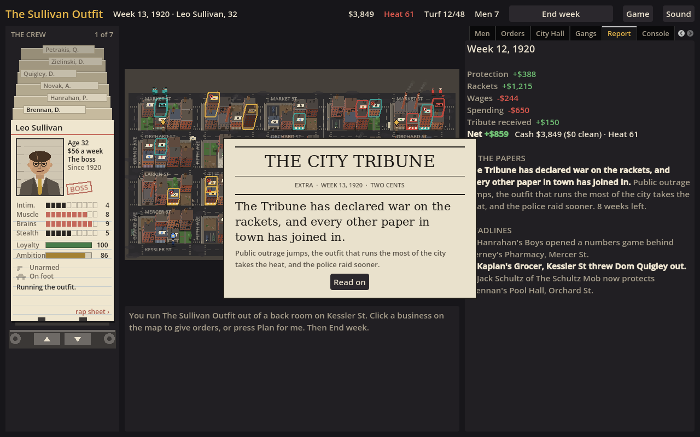

## City sizes

**Game → New city** offers five sizes. A new game starts in a large city, zoomed in on your headquarters; scroll out to see all of it.

| Size | Blocks | Wards | Precincts | Businesses | Outfits at the start / at most |
| --- | --- | --- | --- | --- | --- |
| Small | 5 × 4 | 2 | 1 | 48 | 3 / 6 |
| Medium | 7 × 5 | 4 | 2 | 90 | 4 / 8 |
| Large | 9 × 7 | 6 | 3 | 150 | 5 / 10 |
| Huge | 13 × 10 | 12 | 5 | 300 | 7 / 14 |
| Metropolis | 18 × 14 | 20 | 8 | 600 | 9 / 20 |

The metropolis has a river through the middle, crossed by every avenue on a bridge, with factories along the waterfront. Nobody builds on the river or in the city parks; huge cities have two parks and the metropolis three. Police answer a raid from the nearest precinct house. In a big city that thins out to a few outfits, newcomers move in sooner. Fitted whole on the screen, a big city leaves out the smallest details, such as windows, trade-sign pictures and paving joints, and they come back as you zoom in. Saves from earlier versions load as a small city split into two wards; saves from before the street get their banks when they load.


## Bosses grow old

Every man has an age. Young men get better at the job each year, and men past 55 slow down. Anyone can die of natural causes, and the chance climbs steeply with age, so few bosses see 80.

On the **Men** tab, under **The family**, you can name the man who takes over when your boss dies or goes away for a long stretch. The heir learns the business while he waits, so his brains and other skills creep up. Naming him has a cost: the most ambitious man you passed over takes it badly. If you name nobody, the outfit settles on the obvious man once a year. Once a year you can also bring a son or nephew into the business. He starts young and green, but he's loyal and grows into the job, and family gets the nod when the chair is empty.

When your boss dies, a dialog tells you who runs the outfit now, and you carry on as him. The game is over only if nobody is left to take over.


## Crews

On the **Men** tab, make a man a lieutenant and give him up to three men. When you send a crew, the best man for the job goes in front and the rest back him up. A crew is more likely to make an owner pay, hits harder in a takeover and holds a guard post better. The catch is that every man in it is tied up for the week. A crew takes its mood from its lieutenant: a loyal one steadies his men and a sour one turns them. If an ambitious lieutenant breaks away, his crew goes with him.

Rival gangs send men in pairs and threes too, but only while they are small. A gang that already runs a large part of the district is spread too thin for it.


## Saving

The game saves itself every Sunday and when you close the window. Next time you open it, you carry on where you left off. The **Game** menu has three save slots, loading, and a new city in any of the five sizes. Saves are JSON files in Godot's user folder, under `saves/`.

## Sound

There is a hot-jazz loop with stride piano, brushes and a muted trumpet, under a street ambience of traffic, voices, horns and a streetcar bell. Effects follow the action on the map: a shop bell when an owner pays, a slammed door when he refuses, gunshots in a takeover, whistles for arrests and raids, and the cash register on Sunday. Rivals' sounds play more quietly than yours. The **Sound** button sets the music and effects volumes and has a mute switch.

All of it is synthesised by `tools/make_audio.py` (Python and numpy) into `godot/audio/`. No recorded or third-party audio is used. Run `python3 tools/make_audio.py` to rebuild the files.

## The map

The map is drawn in code from simple shapes, so it uses no image files. It is seen at an angle, the way Gangsters: Organized Crime showed its city: streets and pavements lie flat, and buildings stand up with their front and west walls showing, so a tall building hides what is behind it and people walk behind it too. Downtown has stone office towers, which are taller in the big cities. Elsewhere, the lots that aren't businesses are brick tenements with fire escapes, churches, factories with smoking chimneys, parks, parking lots and vacant ground.

Each business has a sign on its roof showing its trade, such as a barber pole, a coffee cup or a tyre for a garage. The sign is framed in the colours of the gang it pays, and shops facing the viewer have an awning striped in the same colours. A red badge on the roof marks a racket in the back room: a bottle for a speakeasy, a copper pot for a still, a die for numbers, a coin for loans, a horseshoe for a bookie, a playing card for a gambling den and a banknote for a counterfeiting press. Banks have columns and a coin on their sign, gun shops have crossed rifles and a green awning, motor dealers have a glass showroom and cars on the forecourt, and a business that has been burned out stands as a blackened shell, with flames the week it caught. Each gang headquarters has a neon sign and the boss's car parked outside, and the precinct house has columns, blue lamps and patrol cars at the kerb. Cities of five block rows or more have an elevated railway with trains running along it. Traffic, barges on the river and people on the pavements keep the city moving. During the live week the light follows the clock, so streetlamps and windows come on at dusk.

The city is recorded once into layers, one row of buildings at a time from back to front, and panning or zooming only moves those layers. Only the part of the city where something changed, such as a shop changing hands, is drawn again. Each layer goes to the graphics card as one batch of triangles, so a whole metropolis takes fewer draw calls than the flat huge city did before.

Scroll to zoom, and drag with the right or middle mouse button to pan. Trackpad pinch and two-finger scroll also work.


The **Console** tab and `sim play` take the same text orders: `extort <hood> <business>`, `racket <hood> <business> <kind>`, `guard <hood> <business>`, `recruit`, `bribe <dollars>`, `rate <business> <percent>`, `crews`, `crew new <hood>`, `crew add <crew> <hood>`, `send <crew> <business>`, `post <crew> <business>`, `wards`, `payoff <ward>`, `campaign <ward|mayor> <dollars>`, `street`, `hire <person>`, `paycop <person>`, `buystory <person>`, `silence <hood> <person>`, `torch <hood> <business>`, `hit <hood> <target> [backup…]`, `banks`, `rob <hood> <bank> [backup…]`, `hijack <hood> <business> [backup…]`, `shops`, `arm <hood> <pistol|shotgun|tommygun>`, `drive <hood> <modelt|packard|cadillac>`, `hand <from> <to> <gun|car>`, `fronts`, `buy <business>`, `cases`, `lawyer <none|storefront|mouthpiece>`, `judge <hood>`, `jury <hood> <defendant>`, `sheet <hood>`, `relations`, `truce <gang> [tribute]`, `ally <gang>`, `demand <gang> <dollars>`, `break <gang>`, `accept <offer>`, `decline <offer>`, `auto`, `end`. `arm`, `drive`, `buy`, `lawyer`, `judge` and the talks with other gangs act on the spot.

## Systems

- **The city.** It is a grid of blocks, four lots wide and two deep, in one of five sizes (see above). Most lots are businesses; the rest are empty lots, gang headquarters and precinct houses. Owners take a gang less seriously the further its headquarters is: each block beyond the second costs a few points of extortion chance.
- **Protection.** A hood leans on a shop. Success depends on his Intimidation against the owner's toughness. Higher rates pay more but build resentment, and resentful owners talk to the police.
- **Rackets.** These hide behind protected businesses: speakeasies, stills, numbers games, loan books, bookies, gambling dens and counterfeiting presses. Liquor rackets only pay well until repeal in 1934.
- **Turf wars and guards.** A hood sent at a rival's business fights whoever answers the door. That is the guard posted there, otherwise the business's handler. A guard fights harder than a handler who gets called in. The rest of the rival gang only backs him up if it isn't spread thin. Losers can die.
- **Heat.** Rackets, violence and sheer size draw police attention. High heat brings raids, fines, closed rackets and arrests. Bribes cool it, and so do aldermen on the payroll and a mayor who owes you.
- **Trials.** Serious charges go to a jury after three weeks. Lawyers, paid judges and frightened jurors lower the odds of a conviction. Each conviction on a man's rap sheet lengthens his next sentence, and a fourth is life (see above).
- **Diplomacy.** Grudges, truces, tribute and alliances between outfits (see above).
- **Feds.** Treasury tax cases hit gangs holding large amounts of dirty money. They can't be bribed, they seize money, and they can send the boss away. Money washed through a front is out of their reach (see above). Treasury agents also find counterfeiting presses.
- **The street.** Drifters, beat cops, reporters and witnesses (see above). Violent crimes may leave a witness, and a gang that runs hot gets a reporter on its tail.
- **Guns and cars.** A gun adds to a man's strength and his menace; a car gets a job there sooner and gets the men away when it goes wrong (see above).
- **Loyalty.** Unpaid wages and big gangs breed restless lieutenants. An ambitious one can break away with a faction and the businesses its members handle. A boss who dies or gets a long sentence is succeeded, and a rival heir may split the gang.
- **The rival director.** If one gang holds most of the district, the director sows dissent in that gang and brings in an aggressive outside syndicate sized to challenge it. It also steps in if the district goes quiet or if fewer than two gangs are left. Rival gangs with no men, turf or money fold to make room.
- **Difficulty.** On Easy and Normal the player starts with more men and money than the rivals, and rivals hold back from the player's turf for the first year or two. Hard starts everyone level.

## Balance checks

All gangs, including the player's, were run by the AI planner. A city counts as stalled if, in any year, it has fewer than two gangs at some point, one gang holds over 75% of the district all year, or fewer than 3 businesses change hands.

| Check | Small | Medium | Large | Huge | Metropolis |
| --- | --- | --- | --- | --- | --- |
| 10-year cities contested, seeds 1–80 (Normal) | 80/80 | 80/80 | 80/80 | 80/80 | 20/20 (seeds 100–119) |
| 50-year cities contested (Phase 6, before the street) | 10/10 | | 10/10 | 8/8 | |
| Player's gang alive after 3 / 10 years, seeds 1–80 (Normal) | 68/80 / 55/80 | 67/80 / 36/80 | 65/80 / 48/80 | 62/80 / 58/80 | 13/20 / 13/20 (seeds 100–119) |
| Arson / hits / bank jobs / hijacks per city per year | 1.4 / 0.1 / 0.1 / 2.0 | 1.7 / 0.1 / 0.2 / 1.9 | 2.0 / 0.2 / 0.2 / 1.8 | 1.1 / 0.1 / 0.4 / 0.7 | 0.9 / 0.1 / 0.4 / 0.7 |
| Guns and cars bought per city per year; men carrying a gun after 10 years | 48; 46% | 39; 30% | 42; 27% | 53; 21% | 95; 34% |
| Fronts bought and tax cases per city per year; gangs' cash that is clean after 10 years | 1.4, 0.70; 59% | 1.3, 0.88; 54% | 1.4, 1.10; 69% | 1.7, 1.36; 81% | 4.9, 0.97; 93% |
| Trials per city per year; acquitted | 30; 24% | 36; 21% | 37; 19% | 41; 18% | 48; 18% |
| Life sentences for a fourth conviction per city per year; men with a conviction / two or more after 10 years | 0.38; 52% / 18% | 0.29; 47% / 15% | 0.31; 42% / 14% | 0.17; 31% / 8% | 0.15; 27% / 7% |
| Truces / tribute deals / alliances / broken pacts per city per year; pacts standing after 10 years | 3.0 / 13 / 1.9 / 0.9; 6.0 | 1.9 / 15 / 3.0 / 1.2; 5.8 | 1.5 / 15 / 3.3 / 1.2; 5.4 | 1.0 / 13 / 3.0 / 1.0; 4.3 | 1.1 / 15 / 2.4 / 0.8; 5.4 |
| Men run for alderman / own men elected / weeks worked at the polls per city per year; seats held by an outfit's own man after 10 years | 0.71 / 0.21 / 1.3; 0.4 | 0.93 / 0.30 / 2.2; 0.8 | 0.93 / 0.42 / 2.6; 1.1 | 0.98 / 0.48 / 3.0; 1.5 | 1.06 / 0.63 / 3.3; 2.1 |
| Random city events per city per year | 2.5 | 2.6 | 2.5 | 2.6 | 2.6 |
| Men talking to the DA / men who turned / informers' cases / men planted in a rival, per city per year | 2.0 / 0.30 / 0.19 / 0.01 | 2.1 / 0.44 / 0.27 / 0.14 | 2.0 / 0.37 / 0.28 / 0.25 | 2.2 / 0.49 / 0.32 / 0.53 | 2.0 / 0.46 / 0.50 / 0.76 |

These runs include rats. About two men a year in any city start talking to the DA. Half are talked out of it by money for their families, a quarter are seen to in their cells, and the rest sign: about one man every two to three years in a city turns state's evidence. Planted men are rare in a small city, where few outfits hate each other enough, and common in a metropolis, where a planted man passes on about 14 warnings a year between them. The first version made a man in a cell talk only below 35 loyalty, which hardly ever happened. The line now rises with the sentence, so a man facing a long stretch needs looking after. With the line raised, the player's gang lasted three years in 385 of 480 medium cities, against 406 on main. Since then the DA visits less often and fewer men turn informer, the biggest outfit draws twice as many of both, neither the biggest outfit nor the player's autopilot plants men, and rivals no longer send a man they know is a rat after another one. Large cities are now level with main: the player's gang lasts three years in 272 of 320 against 273. Other sizes are a little harder: 383 of 480 medium cities against 406, 195 of 240 huge ones against 207, and 13 of 20 metropolises against 16. Small cities are level on the ten-year runs above. Before rats, with city events, the player's gang was alive after 3 / 10 years in 68/53 small, 68/34 medium, 67/46 large, 69/62 huge and 16/16 metropolis runs.

City events came in the change before. Ten-year runs stop at the end of 1929, so they see the dry squad and the Crash but not the Depression; 40 medium cities run for fifteen years, through the Depression, all stayed contested. The first version left one medium city in 80 (seed 15) run by a single outfit, the player's own on autopilot, for all of 1921. Newspaper crusades now go after whoever runs the most of the city, and that city stays contested. The player's gang lasts about as long as before: alive after three years in 274 of 320 medium cities against 269 before, and in 568 of 640 small ones against 573. In the test of the player's survival on Normal, the small city's first 20 seeds fell from 17 survivors to 14. The test now runs 40 cities and still asks that three in four survive; 33 do. Before city events, with the bigger elections, the player's gang was alive after 3 / 10 years in 71/59 small, 65/35 medium, 56/37 large, 66/63 huge and 15/14 metropolis runs.

The bigger elections came in the change before. Outfits now run their own men for alderman, and in a big city one or two wards end up held by an outfit's own man. About one man in sixteen sent to work the polls is picked up. The ten-year figures move about as much as they do between any two sets of seeds: the large city's three-year survival fell to 255 of 320 runs on seeds 1–320 against 267 on main, but rose to 268 against 260 on seeds 321–640, and turning off the new candidates and poll workers altogether gave 257 and 265. Before the bigger elections, with rap sheets, the player's gang was alive after 3 / 10 years in 72/52 small, 71/34 medium, 66/47 large, 66/63 huge and 19/19 metropolis runs.

Rap sheets came in the change before. Longer sentences for repeat offenders, and life for a fourth conviction, barely move the numbers: about one man goes away for life every three years in a small city, and the player's gang lasts about as long as it did before them (alive after 3 / 10 years in 69/52 small, 71/37 medium, 67/49 large, 66/62 huge and 17/16 metropolis runs). On 160 three-year runs each, the player's gang survived in 134 medium cities against 136 before, and in 133 large ones against 133.

Diplomacy came in the change before. Most deals are short paid truces: a gang taking a beating from an outfit its size or bigger buys three months' peace, and an aggressive outfit leans on a much weaker one. The first version let any two gangs in a fight sign, for half a year, and by year ten most pairs of gangs in a small city had a pact; hijacks fell to a third. Truces now last three months and only the gang on the losing end asks for one. Even so, the outfits fight less than before, and the bigger the city the bigger the drop: hijacks are down about 40% in a small city and 80% in a metropolis, and arson about 10% and 65%. With less lost to fighting, gangs hold more money, so they buy more guns and fronts and draw about twice as many tax cases. The player's gang lasts as long as before or longer. Grudges also pick targets: a gang with a score to settle goes after that outfit first, though a grudge never makes it pick a fight it otherwise wouldn't. When grudges also made gangs fight more, the player's gang lasted three years in 248 of 320 medium cities against 265 before. Before diplomacy, with trials, the player's gang was alive after 3 / 10 years in 66/50 small, 67/37 medium, 68/40 large, 70/58 huge and 17/13 metropolis runs, and arson / hits / bank jobs / hijacks ran at 1.8/0.1/0.1/3.8 small, 2.4/0.2/0.3/4.3 medium, 3.2/0.2/0.4/4.3 large, 2.8/0.2/0.7/3.1 huge and 5.1/0.2/1.1/5.0 metropolis.

Trials came in the change before. When every rival hired a lawyer for every man, the player's gang lasted ten years in only 86 of 160 small cities against 105 before; with rivals going to court only for the boss and heir, it is 99 of 160 small and 79 of 160 medium (81 before). Before trials, with fronts, the player's gang was alive after 3 / 10 years in 64/49 small, 60/42 medium, 60/44 large, 73/54 huge and 17/16 metropolis runs.

Fronts and laundering came in the change before. The first version made fronts too cheap to run and let rivals wash all their money, and the medium city kept the player alive after ten years in only 67 of 160 runs, against 86 without fronts. Fronts now make a little more than protection but wash only half a week's takings, and rivals only buy once they hold enough dirty money for a tax case: 81 of 160. Before fronts, with guns and cars, the player's gang was alive after 3 / 10 years in 65/45 small, 62/43 medium, 60/35 large, 74/54 huge and 19/16 metropolis runs.

Guns and cars came in the change before. Before them, the player's gang was alive after 3 / 10 years in 70/61 small, 67/43 medium, 61/38 large, 73/56 huge and 20/14 metropolis runs. The small city's ten-year figure is the one that moved, but it is noise: on seeds 81–160 the player is alive after ten years in 66/80 with guns and 65/80 without. The first try let the richest gang keep buying, and five large and huge cities ended up run by one outfit; now a gang that holds a third of the city stops buying guns and keeps to three cars, which put every run back to contested.

The people on the street and the new crimes and rackets came in the phase before. Before them, the player's gang was alive after 3 / 10 years in 73/66 small, 67/52 medium, 64/36 large and 77/54 huge cities out of 80. The medium city's ten-year figure fell the most. Hijacks are the commonest new crime because a beer truck is a quick win for a gang with a strong man; hits are rare, since the AI only goes after a rival's best man when the odds are good.

Parks in the huge city leave a few fewer lots to build on, so it was run again on seeds 100–179 after they went in: all 80 stayed contested, and the player's gang was alive in 74/80 after 3 years and 46/80 after 10. A metropolis takes about a minute and a half for ten years on the headless runner, so a week takes under a fifth of a second.

Hard results from Phase 5, before the huge city: alive after 3 / 10 years in 26/40 / 22/40 small, 20/40 / 9/40 medium and 21/40 / 12/40 large cities, with all 40 contested on each.

Phase 4's small city kept the player's gang alive in 71/80 after 3 years and 55/80 after 10, so politics hasn't made the small city harder. Bigger cities are harder to last in: there are more rivals, and the autopilot doesn't pick its fights by ward. With politics turned off (`--no-politics`), the small city gives 68/80 after 3 years on the same build.

The AI is a cautious but simple player; a person paying attention should do better.

## Not done yet

- **Mid-week saves.** If you quit during the live week, you go back to that week's Monday and your orders for it are lost.
- **Crews in the console.** `crews`, `crew new|add|drop`, `send <crew> <biz>` and `post <crew> <biz>` work, but the in-game console only queues orders. It can't send men during the live week.
- **Rival crews.** Rivals put together backup for a single job but don't keep standing crews or lieutenants.
