# Dry Town

An open-ended Prohibition-era crime strategy game, inspired by how *Gangsters: Organized Crime* (1998) plays. It is a new game. It uses none of the original's art, audio, text, code, data or name.

There is no win screen; the city keeps running. Phase 1 built the rules. Phase 2 made a week playable: you plan it on a district map, then watch it happen on the streets. Phase 3 made it a game you can keep coming back to. It saves itself every Sunday, you can run crews under lieutenants, you can step in during the week, and it has sound. Phase 4 let the game outlive your boss: men grow old and die, and the outfit passes to an heir. Phase 5 added politics and bigger cities, and Phase 6 added a huge one. Phase 7, the current state, draws the city at an angle the way Gangsters: Organized Crime did, with buildings standing up off the map, and adds a metropolis split by a river. It also puts people on the street you can deal with (drifters to hire, beat cops to pay off, reporters to buy and witnesses to lean on) and harder crimes: arson, hits, bank jobs and hijacked beer trucks, plus bookies, gambling dens and counterfeiting presses. The city now comes in five sizes, the largest with twenty wards and nine outfits, and every ward has an alderman who can be bought, a mayor who can be backed, and elections that can turn them all out.

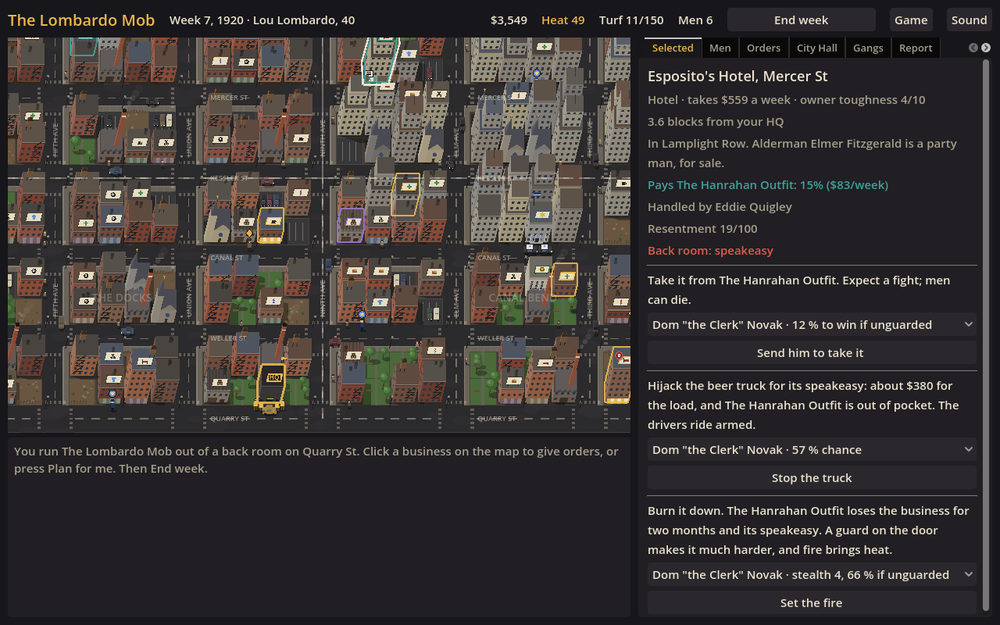

## Layout

| Folder | What it is |
| --- | --- |
| `core/` | The simulation, in plain C# with no Godot dependency. All game rules live here. |
| `sim/` | Console runner: play in the terminal, or soak-test long games. |
| `tests/` | xUnit tests, including the Phase 1 gate (ten-year cities stay contested) and player survival. |
| `godot/` | Godot 4 (.NET) game: district map, planning panels, live week and Sunday report. |

## Run it

You need the [.NET 8 SDK](https://dotnet.microsoft.com/download/dotnet/8.0). To play the game, install the **.NET edition** of Godot 4.7, open `godot/project.godot` and press Play. If your editor is a different 4.x version, it updates the version in `DryTown.csproj` when it opens the project.

```sh
dotnet test tests                                                    # 65 tests
dotnet run --project sim -- play --seed 42                           # play in the terminal
dotnet run --project sim -- soak --seeds 40 --years 10               # balance check across many cities
dotnet run --project sim -- soak --seeds 40 --years 10 --difficulty Hard
dotnet run --project sim -- soak --seeds 40 --years 10 --size Large   # Small, Medium, Large, Huge or Metropolis
```

## How a week works

1. **Plan (Monday morning).** Click a business on the map, and the **Selected** tab shows what you can do there. If it pays nobody, send a man to lean on the owner; the panel shows his chance. If it pays a rival, send a man to take it, and the panel shows his odds if it is unguarded; you can also burn it down, or hijack its beer truck if it runs a speakeasy or a still. On your own turf you can set the protection rate, open a racket in the back room, or post a guard for the week. Banks and people on the street can be clicked too (see **The street** below). The **Men** tab shows your roster and who is busy. On the **Orders** tab you can cancel orders, or press **Plan for me** to have the AI fill your week.
2. **Watch (Monday to Saturday).** Press **End week**. Each order happens at its own hour. Your men walk the streets from your headquarters to the job, and rival gangs and the police do the same. Rings show the outcome: green for success, red for a lost fight, blue for an arrest. A cross marks where someone died. Shops change colour as they change hands. The ticker logs each event as it happens. You can pause, play at 1×, 2×, 4× or 8×, or skip.
   **Stepping in.** Click a business, a bank or someone on the street at any time during the week and the clock pauses. You can send a free man or crew to lean on it, take it, or guard it for the rest of the week. They set out from headquarters straight away and the job happens when they arrive. You can also see rival men walking to their jobs, so you can try to get a guard to a shop before they reach it. New orders stop early on Sunday morning.
3. **Report (Sunday).** Collectors make their rounds, then the police, the Treasury and the gangs settle up. The **Report** tab shows the books and the week's headlines, with your own in bold.

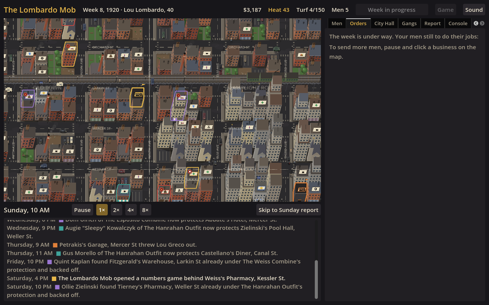

## The street

People who aren't in any gang stand about on the pavements, each with a sign over his head so you can find him from across the city. Click one and the **Selected** tab says who he is and what you can do with him.

- **Drifters** (a yellow diamond) are looking for work. Unlike a stranger off the boat, you can see a drifter's skills before you hire him, and a good one asks more. He moves on after a few weeks.
- **Beat cops** (a blue badge) walk one ward each. Slip one $150 and he looks the other way for the week: your heat drops, and if the police raid you that week they leave your rackets in his ward alone. An honest one won't take it and writes you up instead. The panel tells you which ones look honest.
- **Reporters** (a white card) turn up when a gang runs hot. In a few weeks the story runs: the gang's heat jumps, and so does the city's outrage, which helps the reformers at the polls. You can buy a story about you before it runs; the price goes up with your heat.
- **Witnesses** (a red mark) saw one of your men do something. Unless someone has a word with him first, he testifies and your man goes away for months. A witness with nerve won't scare, and then he goes to the police at once.
- **Rival men** hang about outside their headquarters, and so do yours. Click a rival to put out a hit on him. A boss with soldiers round him is much harder to reach. Someone may see it, and if it goes wrong your man may not come back.

The heavier crimes:

- **Arson.** Burn out a business a rival protects. It stays shut for two months, its racket is gone, and the map shows a blackened shell. A guard on the door makes it much harder.
- **Bank jobs.** Every other ward has a bank. The man in front plans the job, so brains count, and the backup holds the room. Guards, a precinct round the corner and a recent hold-up all count against you. A good take is thousands of dollars, but it brings a lot of heat, and if it goes wrong men are shot or go away for a year or more. The vault fills up again over a couple of months.
- **Hijacking.** While Prohibition lasts, stop a rival's beer truck on its way to his speakeasy or still. You sell the load and he's out of pocket. The drivers ride armed.

Three new rackets go behind your businesses: a **bookie's counter** (pool halls, diners, barbers and tailors), a **gambling den** (hotels, pool halls and warehouses) that pays well but draws heat, and a **counterfeiting press** (warehouses, laundries and garages) that pays best and draws little heat from the precinct, but the Treasury finds a press now and then. When it does, it fines the gang, shuts the business and sends the man who runs it away.

Rival outfits do all of this too. They hire good drifters, buy their own stories, silence witnesses, pay cops when they run hot, rob a bank when money is short, hijack and burn out their neighbours, and now and then put out a hit on a rival's best man.

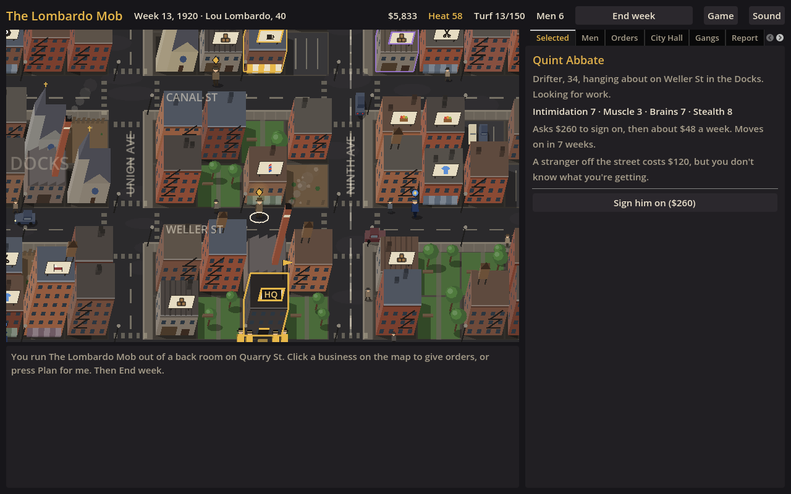
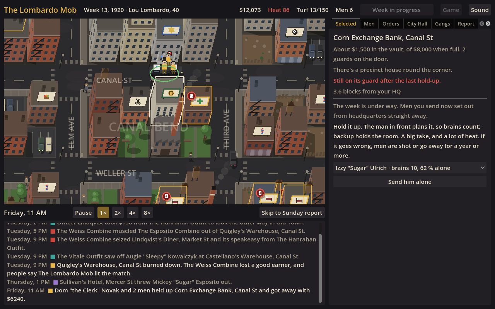

## City Hall

The city is split into wards, and each ward has an alderman. Open the **City Hall** tab and the map shows the wards, each washed in the colour of the outfit that owns its alderman. Click a ward on the map or in the list to see who runs it.

- **Aldermen.** A party man can be put on your payroll for a one-off envelope, then a weekly one that grows with the number of shops in his ward. While he's yours, he tips off your rackets in his ward before the police arrive, makes shopkeepers' complaints go away, and cools your heat a little every week. A man who just took one outfit's money won't hear another offer for half a year; after that a rival can turn him for double. Miss a Sunday envelope and he stops taking your calls.
- **Reformers.** A reformer won't take an envelope, and offering one gets you in the papers. The only way to be rid of him is to beat him at the polls.
- **Elections.** Aldermen are elected every second November and the mayor every fourth April. For eight weeks before each vote you can put money behind your man. Money counts, so do the shops you run in his ward, and so does a sitting alderman's machine. Every $400 you spend on the street draws a little heat.
- **The mayor.** A machine mayor leaves the town wide open, and the outfit that paid most for his win has the police go easy on it. A reform mayor's police raid sooner and his aldermen cost twice as much to buy. Killings in the papers drive up public outrage, and outrage wins elections for reformers.

Rival outfits play too. They buy the alderman where they do most of their business, defend him at election time, and back the machine's man for mayor when they can afford to.

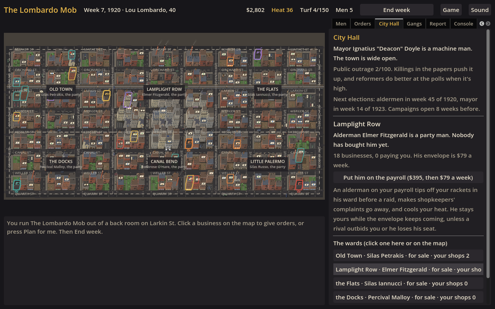

## City sizes

**Game → New city** offers five sizes. A new game starts in a large city, zoomed in on your headquarters; scroll out to see all of it.

| Size | Blocks | Wards | Precincts | Businesses | Outfits at the start / at most |
| --- | --- | --- | --- | --- | --- |
| Small | 5 × 4 | 2 | 1 | 48 | 3 / 6 |
| Medium | 7 × 5 | 4 | 2 | 90 | 4 / 8 |
| Large | 9 × 7 | 6 | 3 | 150 | 5 / 10 |
| Huge | 13 × 10 | 12 | 5 | 300 | 7 / 14 |
| Metropolis | 18 × 14 | 20 | 8 | 600 | 9 / 20 |

The metropolis has a river through the middle, crossed by every avenue on a bridge, with factories along the waterfront. Nobody builds on the river or in the city parks; huge cities have two parks and the metropolis three. Police answer a raid from the nearest precinct house. In a big city that thins out to a few outfits, newcomers move in sooner. Fitted whole on the screen, a big city leaves out the smallest details, such as windows, trade-sign pictures and paving joints, and they come back as you zoom in. Saves from earlier versions load as a small city split into two wards; saves from before the street get their banks when they load.

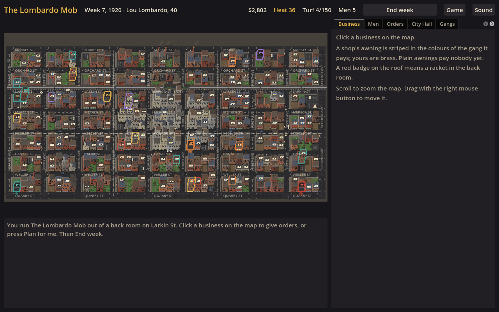
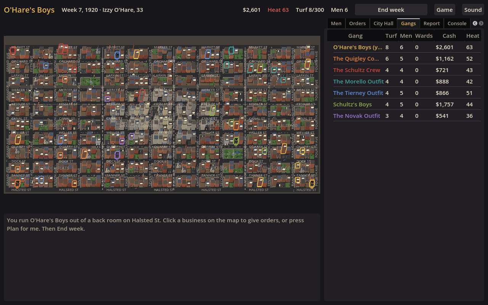
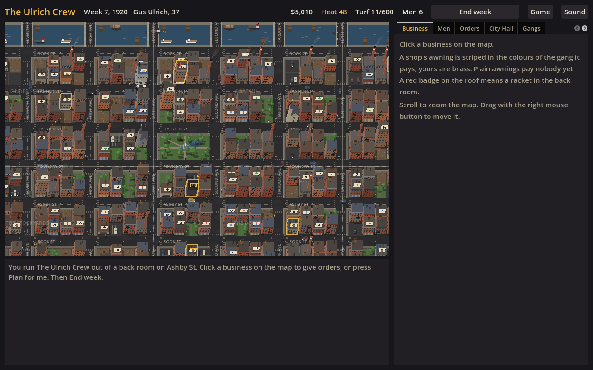

## Bosses grow old

Every man has an age. Young men get better at the job each year, and men past 55 slow down. Anyone can die of natural causes, and the chance climbs steeply with age, so few bosses see 80.

On the **Men** tab, under **The family**, you can name the man who takes over when your boss dies or goes away for a long stretch. The heir learns the business while he waits, so his brains and other skills creep up. Naming him has a cost: the most ambitious man you passed over takes it badly. If you name nobody, the outfit settles on the obvious man once a year. Once a year you can also bring a son or nephew into the business. He starts young and green, but he's loyal and grows into the job, and family gets the nod when the chair is empty.

When your boss dies, a dialog tells you who runs the outfit now, and you carry on as him. The game is over only if nobody is left to take over.

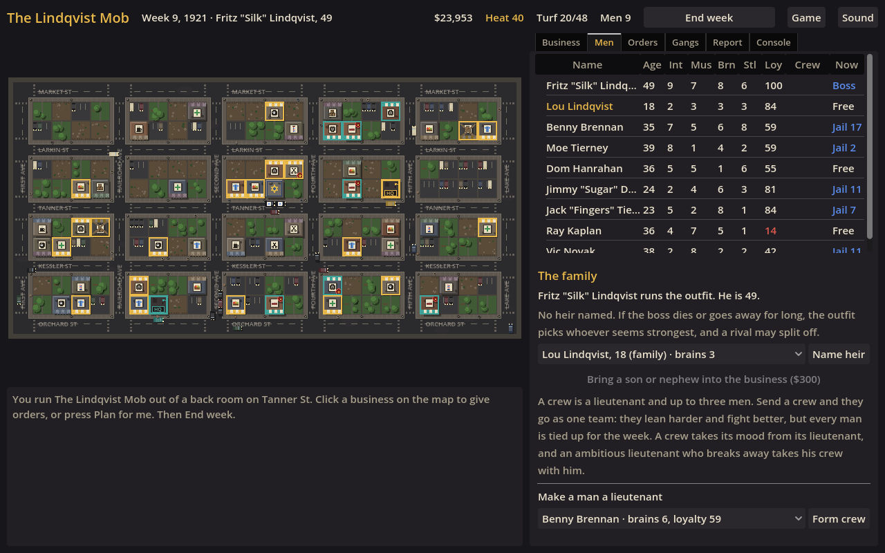

## Crews

On the **Men** tab, make a man a lieutenant and give him up to three men. When you send a crew, the best man for the job goes in front and the rest back him up. A crew is more likely to make an owner pay, hits harder in a takeover and holds a guard post better. The catch is that every man in it is tied up for the week. A crew takes its mood from its lieutenant: a loyal one steadies his men and a sour one turns them. If an ambitious lieutenant breaks away, his crew goes with him.

Rival gangs send men in pairs and threes too, but only while they are small. A gang that already runs a large part of the district is spread too thin for it.

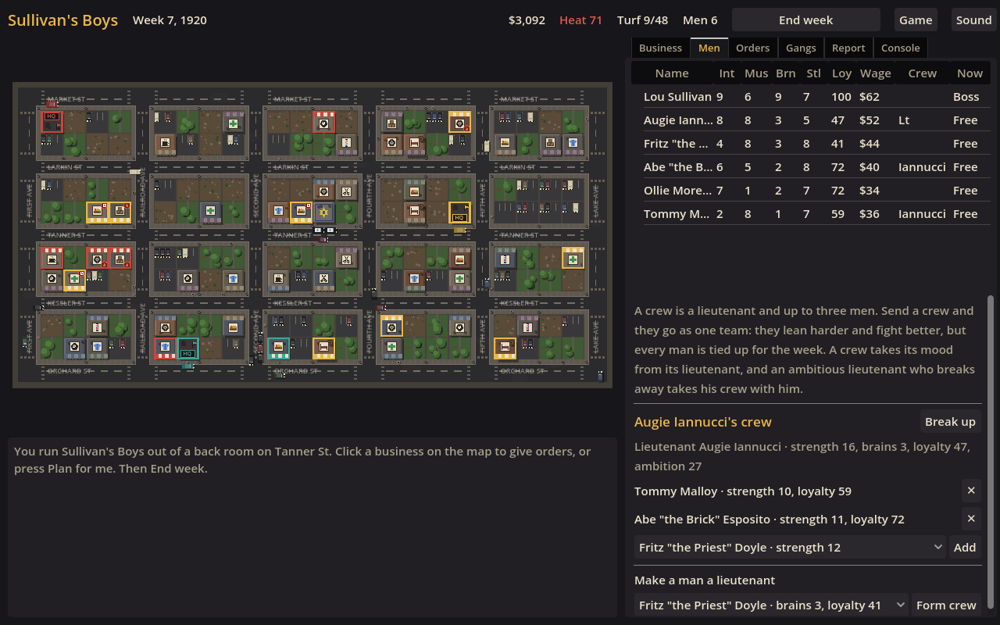

## Saving

The game saves itself every Sunday and when you close the window. Next time you open it, you carry on where you left off. The **Game** menu has three save slots, loading, and a new city in any of the five sizes. Saves are JSON files in Godot's user folder, under `saves/`.

## Sound

There is a hot-jazz loop with stride piano, brushes and a muted trumpet, under a street ambience of traffic, voices, horns and a streetcar bell. Effects follow the action on the map: a shop bell when an owner pays, a slammed door when he refuses, gunshots in a takeover, whistles for arrests and raids, and the cash register on Sunday. Rivals' sounds play more quietly than yours. The **Sound** button sets the music and effects volumes and has a mute switch.

All of it is synthesised by `tools/make_audio.py` (Python and numpy) into `godot/audio/`. No recorded or third-party audio is used. Run `python3 tools/make_audio.py` to rebuild the files.

## The map

The map is drawn in code from simple shapes, so it uses no image files. It is seen at an angle, the way Gangsters: Organized Crime showed its city: streets and pavements lie flat, and buildings stand up with their front and west walls showing, so a tall building hides what is behind it and people walk behind it too. Downtown has stone office towers, which are taller in the big cities. Elsewhere, the lots that aren't businesses are brick tenements with fire escapes, churches, factories with smoking chimneys, parks, parking lots and vacant ground.

Each business has a sign on its roof showing its trade, such as a barber pole, a coffee cup or a tyre for a garage. The sign is framed in the colours of the gang it pays, and shops facing the viewer have an awning striped in the same colours. A red badge on the roof marks a racket in the back room: a bottle for a speakeasy, a copper pot for a still, a die for numbers, a coin for loans, a horseshoe for a bookie, a playing card for a gambling den and a banknote for a counterfeiting press. Banks have columns and a coin on their sign, and a business that has been burned out stands as a blackened shell, with flames the week it caught. Each gang headquarters has a neon sign and the boss's car parked outside, and the precinct house has columns, blue lamps and patrol cars at the kerb. Cities of five block rows or more have an elevated railway with trains running along it. Traffic, barges on the river and people on the pavements keep the city moving. During the live week the light follows the clock, so streetlamps and windows come on at dusk.

The city is recorded once into layers, one row of buildings at a time from back to front, and panning or zooming only moves those layers. Only the part of the city where something changed, such as a shop changing hands, is drawn again. Each layer goes to the graphics card as one batch of triangles, so a whole metropolis takes fewer draw calls than the flat huge city did before.

Scroll to zoom, and drag with the right or middle mouse button to pan. Trackpad pinch and two-finger scroll also work.

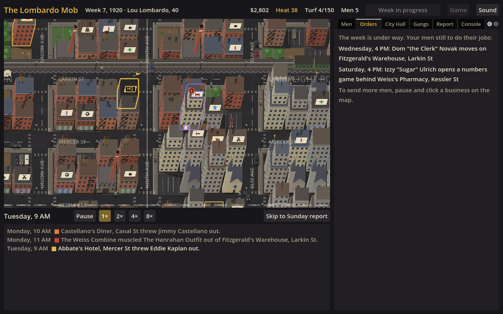
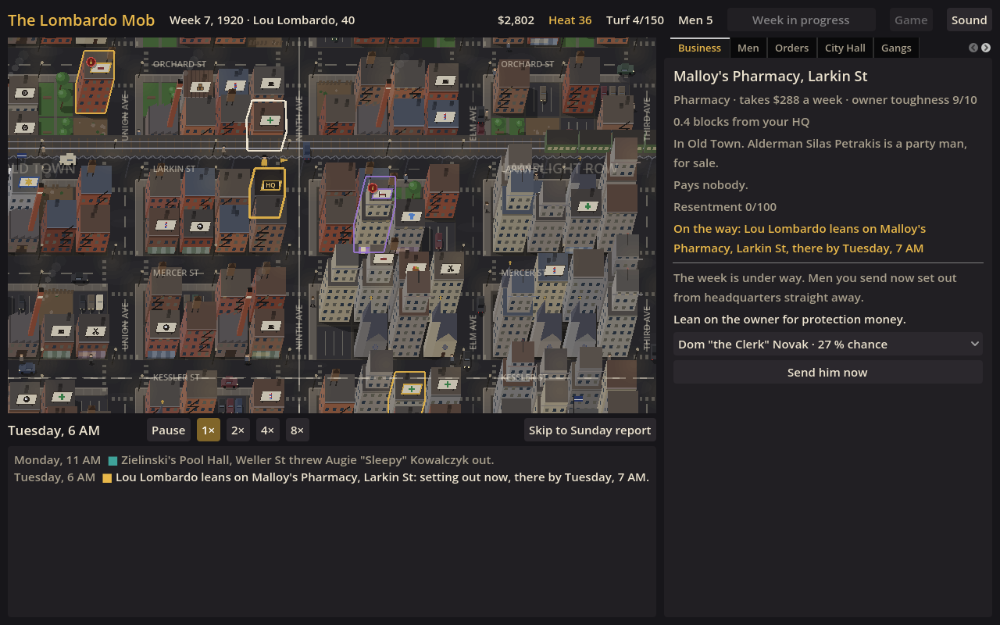
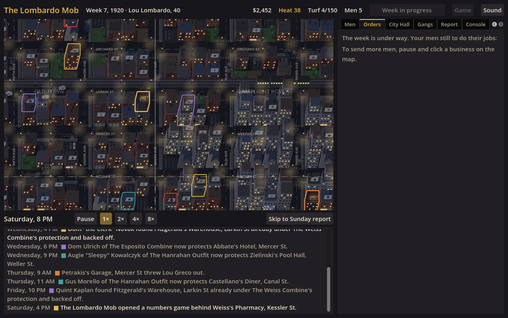

The **Console** tab and `sim play` take the same text orders: `extort <hood> <business>`, `racket <hood> <business> <kind>`, `guard <hood> <business>`, `recruit`, `bribe <dollars>`, `rate <business> <percent>`, `crews`, `crew new <hood>`, `crew add <crew> <hood>`, `send <crew> <business>`, `post <crew> <business>`, `wards`, `payoff <ward>`, `campaign <ward|mayor> <dollars>`, `street`, `hire <person>`, `paycop <person>`, `buystory <person>`, `silence <hood> <person>`, `torch <hood> <business>`, `hit <hood> <target> [backup…]`, `banks`, `rob <hood> <bank> [backup…]`, `hijack <hood> <business> [backup…]`, `auto`, `end`.

## Systems

- **The city.** It is a grid of blocks, four lots wide and two deep, in one of five sizes (see above). Most lots are businesses; the rest are empty lots, gang headquarters and precinct houses. Owners take a gang less seriously the further its headquarters is: each block beyond the second costs a few points of extortion chance.
- **Protection.** A hood leans on a shop. Success depends on his Intimidation against the owner's toughness. Higher rates pay more but build resentment, and resentful owners talk to the police.
- **Rackets.** These hide behind protected businesses: speakeasies, stills, numbers games, loan books, bookies, gambling dens and counterfeiting presses. Liquor rackets only pay well until repeal in 1934.
- **Turf wars and guards.** A hood sent at a rival's business fights whoever answers the door. That is the guard posted there, otherwise the business's handler. A guard fights harder than a handler who gets called in. The rest of the rival gang only backs him up if it isn't spread thin. Losers can die.
- **Heat.** Rackets, violence and sheer size draw police attention. High heat brings raids, fines, closed rackets and arrests. Bribes cool it, and so do aldermen on the payroll and a mayor who owes you.
- **Feds.** Treasury tax cases hit gangs holding large amounts of cash. They can't be bribed, they seize money, and they can send the boss away. Treasury agents also find counterfeiting presses.
- **The street.** Drifters, beat cops, reporters and witnesses (see above). Violent crimes may leave a witness, and a gang that runs hot gets a reporter on its tail.
- **Loyalty.** Unpaid wages and big gangs breed restless lieutenants. An ambitious one can break away with a faction and the businesses its members handle. A boss who dies or gets a long sentence is succeeded, and a rival heir may split the gang.
- **The rival director.** If one gang holds most of the district, the director sows dissent in that gang and brings in an aggressive outside syndicate sized to challenge it. It also steps in if the district goes quiet or if fewer than two gangs are left. Rival gangs with no men, turf or money fold to make room.
- **Difficulty.** On Easy and Normal the player starts with more men and money than the rivals, and rivals hold back from the player's turf for the first year or two. Hard starts everyone level.

## Balance checks

All gangs, including the player's, were run by the AI planner. A city counts as stalled if, in any year, it has fewer than two gangs at some point, one gang holds over 75% of the district all year, or fewer than 3 businesses change hands.

| Check | Small | Medium | Large | Huge | Metropolis |
| --- | --- | --- | --- | --- | --- |
| 10-year cities contested, seeds 1–80 (Normal) | 80/80 | 80/80 | 80/80 | 80/80 | 40/40 (seeds 100–139) |
| 50-year cities contested | 10/10 | | 10/10 | 8/8 | |
| Player's gang alive after 3 / 10 years, seeds 1–80 (Normal) | 73/80 / 66/80 | 67/80 / 52/80 | 64/80 / 36/80 | 77/80 / 54/80 | 38/40 / 36/40 (seeds 100–139) |

Parks in the huge city leave a few fewer lots to build on, so it was run again on seeds 100–179 after they went in: all 80 stayed contested, and the player's gang was alive in 74/80 after 3 years and 46/80 after 10. A metropolis takes about a minute and a half for ten years on the headless runner, so a week takes under a fifth of a second.

Hard results from Phase 5, before the huge city: alive after 3 / 10 years in 26/40 / 22/40 small, 20/40 / 9/40 medium and 21/40 / 12/40 large cities, with all 40 contested on each.

Phase 4's small city kept the player's gang alive in 71/80 after 3 years and 55/80 after 10, so politics hasn't made the small city harder. Bigger cities are harder to last in: there are more rivals, and the autopilot doesn't pick its fights by ward. With politics turned off (`--no-politics`), the small city gives 68/80 after 3 years on the same build.

The AI is a cautious but simple player; a person paying attention should do better.

## Not done yet

- **Mid-week saves.** If you quit during the live week, you go back to that week's Monday and your orders for it are lost.
- **Crews in the console.** `crews`, `crew new|add|drop`, `send <crew> <biz>` and `post <crew> <biz>` work, but the in-game console only queues orders. It can't send men during the live week.
- **Rival crews.** Rivals put together backup for a single job but don't keep standing crews or lieutenants.
